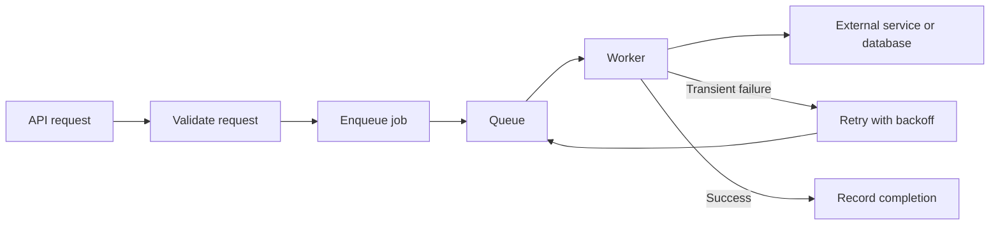

# Reliable Background Jobs: Retries, Backoff, and Idempotency

## The problem

Moving slow work to a background queue can make an API more responsive and isolate workloads. But queues introduce new failure modes: workers crash, jobs time out, dependencies become unavailable, and a job may run more than once.

A queue is not a guarantee that a side effect happens exactly once.

## Typical flow



The diagram is conceptual. Real systems also need durable job state, monitoring, timeout handling, and a strategy for jobs that repeatedly fail.

## Classify failures

**Potentially transient failures**
- Rate limits.
- Temporary network errors.
- Brief dependency outages.
- Some service-unavailable responses.

**Likely permanent failures**
- Invalid input.
- Missing required configuration.
- Unsupported operations.
- Authentication or authorization errors that need intervention.

Retrying every error wastes resources and can make an outage worse. Retry policy should reflect the error class and the dependency's contract.

## Exponential backoff and jitter

A common backoff grows the delay after each failure:

\[
d_n = \min(d_{\max}, d_0 \times 2^n)
\]

where \(d_0\) is the initial delay, \(d_{\max}\) is the cap, and \(n\) is the retry index.

Jitter adds randomness so many workers do not retry simultaneously. One common full-jitter approach samples a delay uniformly between zero and the capped exponential delay.

The exact retry count, delay cap, and jitter policy should be chosen according to the service's latency and rate-limit constraints. Respect server-provided retry guidance when applicable.

## Idempotency: make repeated execution safe

A worker can perform a side effect and crash before recording success. The queue may then deliver the job again.

For a database operation, a unique business key or idempotency key can prevent duplicate records. For an external API, use the provider's idempotency mechanism when available.

A conceptual database pattern:

```sql
CREATE TABLE processed_events (
    event_id TEXT PRIMARY KEY,
    processed_at TIMESTAMPTZ NOT NULL DEFAULT now()
);
```

This table alone does not guarantee correctness. Claiming the event and applying the business mutation must be coordinated transactionally, and the design must define what happens if processing fails midway.

For external side effects, a local database transaction cannot atomically commit both the local write and the remote API call. Consider an outbox, provider-side idempotency keys, reconciliation, and explicit state transitions.

## Dead-letter handling

After bounded retries, a job may be moved to a failed or dead-letter state for inspection. A useful operational workflow records:
- Job and correlation IDs.
- Attempt count and timestamps.
- Sanitized error details.
- Relevant business entity ID.
- A safe replay mechanism.
- Metrics and alerts for failure rates and queue age.

Never put secrets or unnecessary personal data into job logs.

## Ordering and concurrency

Retries and multiple workers can change completion order. If jobs for the same entity must be serialized, consider partitioning, per-entity locks, queue groups, or database-level concurrency control. Each option has different throughput and failure trade-offs.

Limit concurrency to protect dependencies. More workers do not always mean more throughput; they can exhaust database connections or trigger provider rate limits.

## Practical checklist

- [ ] Classify retryable versus permanent failures.
- [ ] Use bounded retries with backoff and jitter where appropriate.
- [ ] Make side effects idempotent or detect duplicates.
- [ ] Set timeouts for external calls.
- [ ] Define failed-job inspection and replay.
- [ ] Monitor queue depth, oldest-job age, processing latency, and failure rate.
- [ ] Test worker crashes before and after a side effect.
- [ ] Document ordering guarantees and concurrency limits.

## Takeaways

- Assume jobs can run more than once.
- Retries need idempotency, limits, and observability.
- A successful side effect followed by a worker crash is a key failure case to test.
- "Exactly once" claims need a precise boundary and careful qualification.

## References

- [BullMQ: Retrying failing jobs](https://docs.bullmq.io/guide/retrying-failing-jobs)
- [BullMQ: Idempotent jobs](https://docs.bullmq.io/patterns/idempotent-jobs)
- [AWS Builders' Library: Timeouts, retries, and backoff with jitter](https://aws.amazon.com/builders-library/timeouts-retries-and-backoff-with-jitter/)
