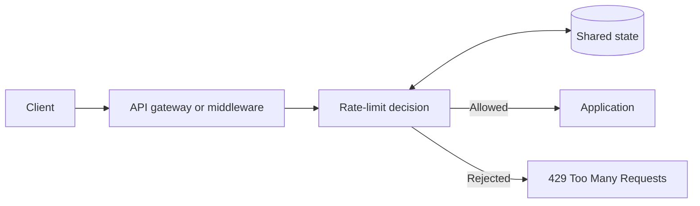

# System Design: Rate Limiter

## Problem statement

A rate limiter controls how frequently a client can perform an action. It can protect a service from accidental overload, abusive traffic, or uneven usage.

Before choosing an algorithm, define:
- What is being limited: requests, login attempts, messages, or compute cost?
- Who is the subject: IP, user, API key, tenant, or endpoint?
- What is the limit and time window?
- Is a small burst allowed?
- What happens when the limiter's storage is unavailable?
- Does the limit need to be globally consistent across regions?

## Common algorithms

| Algorithm | Strengths | Trade-offs |
|---|---|---|
| Fixed window | Simple, low storage cost | Boundary bursts can allow nearly twice the nominal rate around adjacent windows |
| Sliding log | Accurate rolling window | Stores timestamps per request; can be expensive at high volume |
| Sliding window counter | Approximate rolling window with lower storage | Approximation depends on the implementation |
| Token bucket | Allows controlled bursts while enforcing an average rate | Requires careful token refill and state handling |
| Leaky bucket | Smooths outgoing work at a controlled rate | May delay or reject bursts depending on implementation |

## Token bucket mental model

A bucket holds up to \(C\) tokens. Tokens refill at rate \(r\) per second, up to capacity \(C\). A request costing \(k\) tokens is allowed if at least \(k\) tokens are available; otherwise it is rejected or delayed.

This permits bursts up to the bucket capacity while controlling the long-term rate.

A correct implementation must handle elapsed time, capacity, concurrent updates, and clock assumptions. In a distributed deployment, two application instances must not independently grant the same shared quota without coordination.

## High-level architecture

The shared state might be Redis or a dedicated gateway service. If Redis is used, a read-modify-write sequence split across separate commands can race under concurrency. Use an atomic operation, such as a carefully designed Lua script, or a supported limiter implementation.

## HTTP behavior

For a rejected request, an API commonly responds with `429 Too Many Requests`. Where appropriate, return retry guidance and document the quota policy. Be consistent about whether failed requests consume quota.

Rate limiting is not a replacement for authentication, authorization, abuse detection, or resource-level protection.

## Distributed-system trade-offs

**Centralized shared state**
- Produces a more consistent limit across instances.
- Adds network latency and a dependency.
- Requires capacity planning and failure handling.

**Per-instance state**
- Is simple and fast.
- Can multiply the effective limit by the number of instances.
- Can be useful for coarse local protection, but is not a strict global quota.

**Fail open vs. fail closed**
- Fail open preserves availability when the limiter is unavailable, but traffic may exceed the intended limit.
- Fail closed preserves the limit, but can block legitimate traffic during a limiter outage.

The choice depends on the endpoint. Login protection, public read APIs, and critical internal operations may need different policies.

## Practical design checklist

- [ ] Define the quota key and scope.
- [ ] Choose an algorithm based on burst and accuracy requirements.
- [ ] Make shared-state updates atomic.
- [ ] Define behavior on limiter failure.
- [ ] Return documented rejection responses.
- [ ] Add metrics for allowed, rejected, and failed limiter checks.
- [ ] Test concurrent requests and boundary conditions.
- [ ] Prevent clients from bypassing limits by changing untrusted identity fields.

## Takeaways

- Algorithm choice follows the product requirement, not fashion.
- Distributed quotas require shared coordination or accepted approximation.
- Atomic state updates are essential under concurrency.
- Failure behavior is part of the system design, not an afterthought.

## Further reading

- [Redis: Rate limiter pattern](https://redis.io/docs/latest/develop/use/patterns/rate-limiter/)
- [RFC 6585: 429 Too Many Requests](https://www.rfc-editor.org/rfc/rfc6585)
